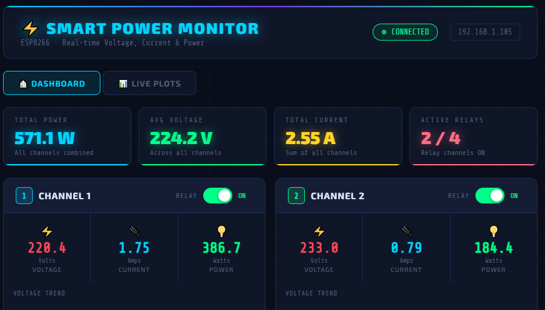
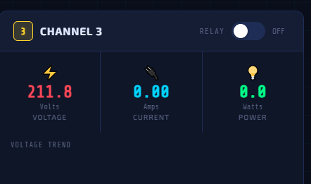
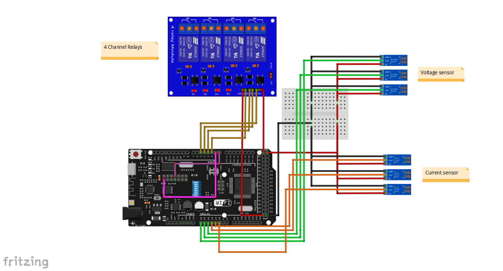
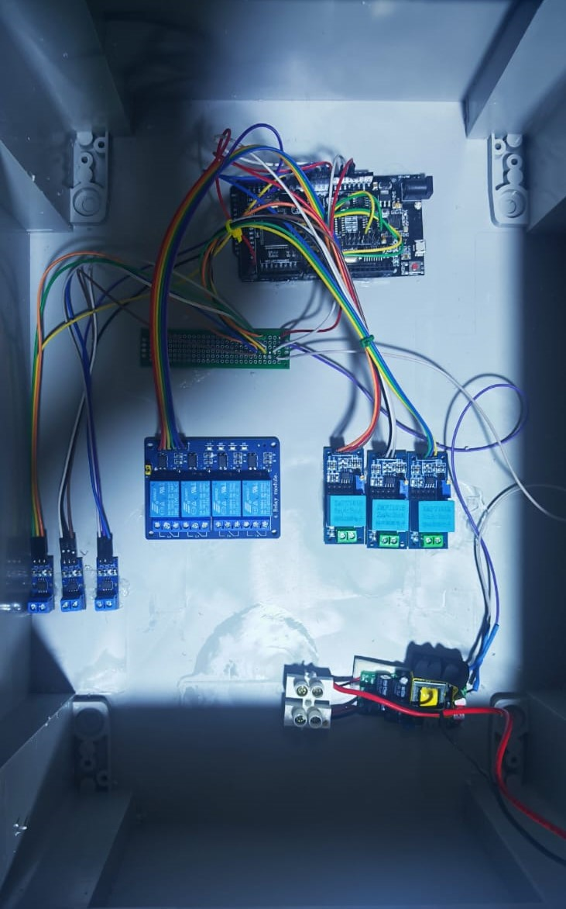

# IoT-Based AC Power Monitoring and Load Control Platform

An embedded AC power monitoring platform built with an **Arduino Uno R3**, **ESP8266**, **ZMPT101B voltage sensors**, **ACS712 current sensors**, and a **4-channel relay module**. The system measures three AC channels, sends readings to the ESP8266 over serial communication, serves a browser-based dashboard, and supports remote relay switching over the local network.



## Features

- Three-channel RMS voltage monitoring using ZMPT101B sensors.
- Three-channel RMS current monitoring using ACS712 sensors.
- Four independently controlled relay outputs.
- Serial communication between the Arduino Uno and ESP8266.
- Responsive web dashboard hosted directly on the ESP8266.
- Real-time voltage, current, and estimated power display.
- Historical voltage/current plots and live power/energy visualization.
- REST-style endpoints for live data, history, and relay control.
- Fritzing wiring project and hardware documentation included.

## System Architecture

```text
AC Sources / Loads
      |
      +--> ZMPT101B Voltage Sensors ---+
      |                                |
      +--> ACS712 Current Sensors ------+--> Arduino Uno R3
                                              |
                                              | Serial @ 115200 baud
                                              v
                                           ESP8266
                                              |
                                              | Wi-Fi
                                              v
                                      Web Dashboard / Browser
                                              |
                                              v
                                      4-Channel Relay Control
```

## Hardware

| Component | Quantity | Purpose |
|---|---:|---|
| Arduino Uno R3 | 1 | Sensor acquisition and relay control |
| ESP8266 | 1 | Wi-Fi connectivity and web dashboard |
| ZMPT101B voltage sensor | 3 | AC RMS voltage measurement |
| ACS712 current sensor | 3 | AC RMS current measurement |
| 4-channel relay module | 1 | Load switching |
| AC loads / test channels | 3 | Demonstration and testing |
| Breadboard / wiring / power supply | As required | Prototype interconnection |

## Pin Mapping

### Arduino Uno R3

| Function | Pin |
|---|---|
| ZMPT101B Channel 1 | A0 |
| ZMPT101B Channel 2 | A1 |
| ZMPT101B Channel 3 | A2 |
| ACS712 Channel 1 | A3 |
| ACS712 Channel 2 | A4 |
| ACS712 Channel 3 | A5 |
| Relay 1 | D4 |
| Relay 2 | D5 |
| Relay 3 | D6 |
| Relay 4 | D7 |

## Repository Structure

All files are kept directly in the repository root for simple GitHub upload and access:

```text
README.md
LICENSE
SAFETY.md
ac_power_monitor_arduino_uno.ino
ac_power_web_dashboard_esp8266.ino
ac_power_monitoring_wiring.fzz
wiring_diagram.png
prototype_hardware.jpg
dashboard_overview.png
channel_monitoring.png
project_report.pdf
project_presentation.pptx
```

## Arduino Firmware

The Arduino firmware performs the following tasks:

1. Reads three ZMPT101B voltage channels.
2. Reads three ACS712 current channels.
3. Applies RMS calculations and simple current range filtering.
4. Sends readings and relay states to the ESP8266 every 500 ms.
5. Accepts relay commands from the ESP8266.

Serial data format:

```text
DATA:V1,V2,V3,C1,C2,C3,R1,R2,R3,R4
```

Example:

```text
DATA:221.40,223.10,219.80,0.52,0.31,0.74,1,0,1,0
```

## ESP8266 Web Dashboard

The ESP8266 receives measurements from the Arduino and hosts the user interface. The current firmware exposes:

| Endpoint | Purpose |
|---|---|
| `/` | Main monitoring dashboard |
| `/plots` | Live plots page |
| `/api/data` | Latest voltage, current, and relay states |
| `/api/history` | Recent voltage/current history |
| `/api/relay` | Relay-control endpoint |

The dashboard estimates channel power as:

```text
P_est = V_rms × I_rms
```

This is an apparent/approximate power value unless power factor is independently measured. The dashboard energy plot is therefore intended for demonstration rather than revenue-grade metering.

## Setup

### 1. Arduino Uno

Open:

```text
ac_power_monitor_arduino_uno.ino
```

Install the required ZMPT101B library in the Arduino IDE, select the correct board/port, then upload the sketch.

### 2. ESP8266

Open:

```text
ac_power_web_dashboard_esp8266.ino
```

Replace:

```cpp
const char* ssid     = "YOUR_WIFI_SSID";
const char* password = "YOUR_WIFI_PASSWORD";
```

with credentials for the Wi-Fi network used during testing. Upload the sketch to the ESP8266 and open the IP address printed in the serial monitor.

### 3. Serial Link

Both sketches use **115200 baud**. Connect the boards using a serial link appropriate for their logic levels and hardware configuration. Do not connect incompatible voltage levels directly without proper level shifting/protection.

## Calibration

The project contains calibration constants for the voltage and current sensors. These values are hardware-dependent and should be checked against a trusted multimeter or calibrated instrument before relying on measurements.

The Arduino sketch also contains a configurable current noise floor and maximum expected current. Review these limits for your own hardware and loads.

## Screenshots

### Main Dashboard


### Channel Monitoring



### Wiring Diagram



### Prototype



## Notes and Limitations

- The current implementation targets a three-channel monitoring prototype and four relay outputs.
- Power is estimated from RMS voltage and current and does not include measured phase angle/power factor.
- Sensor calibration must be repeated for different modules and installations.
- The browser plots use Chart.js loaded from a CDN, so the plots page requires internet access unless the library is hosted locally.
- The included design is intended for educational and prototyping use, not certified billing or protection applications.

## Documentation

The files `project_report.pdf` and `project_presentation.pptx` contain the project report and presentation supplied with the original project materials.

## License

Source code in this repository is released under the MIT License. Project reports, presentation material, photographs, and third-party assets remain subject to their respective authors' or owners' rights unless explicitly stated otherwise.

## Acknowledgment

This repository reorganizes an academic AC power monitoring project into a reproducible open-source structure for students, researchers, and embedded-systems developers.
